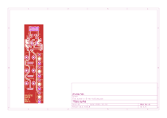

# suma

## Revisiones

- `v0.1 rev-a`: diseñada en octubre 2026 y fabricada en JLCPCB. No funciona tal como viene armada: los diodos de protección quedaron al revés y los potenciómetros también (ver abajo).
- `v0.1 rev-b`: en desarrollo. Corrige las huellas de los diodos y de los potenciómetros, quita la salida invertida (J6 y R8) y agrega el panel. Simulada con ngspice: 4.95 Vpp de salida con 5 Vpp de entrada y el potenciómetro al máximo.

### Errores conocidos de rev-a

El esquemático está bien; los errores están en las huellas.

- **Diodos D1 y D2 al revés.** La serigrafía de la huella marca el cátodo en el pad contrario al del símbolo, y JLCPCB montó los diodos siguiendo la serigrafía. Los rieles caen a unos ±1.5 V en vez de ±11.7 V, y la salida sale muy baja (~1 Vpp en vez de 5 Vpp) y deformada.
- **Potenciómetros al revés.** La huella tiene los pads 1 y 3 intercambiados: girando en sentido horario baja el volumen.

Para comprobarlo en una placa: con el módulo alimentado, medir el pin 8 y el pin 4 de U1 respecto a GND. Si da ~±1-2 V en vez de ~±11.7 V, los diodos están al revés.

Arreglo de las placas rev-a ya armadas:

- Desoldar D1 y D2 y soldarlos girados 180°. Para probar rápido, también se pueden puentear con un cable (se pierde la protección contra polaridad inversa).
- Los potenciómetros no tienen arreglo limpio: esas placas funcionan al revés (antihorario = más volumen).

El esquemático, la placa y la Bill of materials de abajo son todavía los de rev-a. La Bill of materials incluye J6 y R8, que rev-b ya no lleva.

## Esquemático y placa (v0.1 rev-a)

Generados automáticamente por GitHub Actions a partir de `hardware/suma-v-0-rev-a/suma-v-0-rev-a.kicad_sch` y `.kicad_pcb` en cada push que los modifica.

## Bill of materials (v0.1 rev-a)

Generado a partir de `hardware/suma-v-0-rev-a/suma-v-0-rev-a.kicad_sch`.

<!-- BOM_TABLE_START -->

| Referencias | Cantidad | Valor | Huella | Descripción |
| --- | --- | --- | --- | --- |
| C1, C2 | 2 | 100n | suma-v-0-rev-a:C0805 | suma-v-0-rev-a:C |
| D1, D2 | 2 | 1N5817W | suma-v-0-rev-a:SOD-123FL_L2.8-W1.8-LS3.7-R-RD | suma-v-0-rev-a:D_Schottky |
| J1, J2, J3, J5, J6 | 5 | AudioJack2_SwitchT | suma-v-0-rev-a:Jack_3.5mm_QingPu_WQP-PJ398SM_Vertical | suma-v-0-rev-a:AudioJack2_SwitchT |
| J4 | 1 | Conn_02x05_Odd_Even | suma-v-0-rev-a:IDC-Header_2x05_P2.54mm_Vertical | suma-v-0-rev-a:Conn_02x05_Odd_Even |
| R1, R2, R3, R4, R5, R6 | 6 | 100k | suma-v-0-rev-a:R0805 | suma-v-0-rev-a:R |
| R7, R8 | 2 | 1k | suma-v-0-rev-a:R0805 | suma-v-0-rev-a:R |
| RV1, RV2, RV3 | 3 | A100k | suma-v-0-rev-a:POT_TH_Alps_RK09K_Single_Vertical | suma-v-0-rev-a:R_Potentiometer |
| U1 | 1 | TL072 | suma-v-0-rev-a:SOIC-8_L4.9-W3.9-P1.27-LS6.0-BL | suma-v-0-rev-a:TL072 |

22 componentes en total.

<!-- BOM_TABLE_END -->

## Créditos

- Aarón Montoya-Moraga: investigación, esquemático, PCB, fabricación y documentación.

## Licencia

El hardware está bajo CERN-OHL-P-2.0 y esta documentación bajo CC-BY-SA-4.0. Ver [LICENSE.md](https://github.com/piruetasxyz/suma/blob/main/LICENSE.md).
