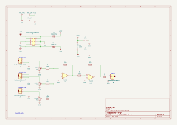

# suma

## Revisiones

- `v0.1 rev-b`: fabricada y probada en noviembre 2026. Corrige las huellas de los diodos y de los potenciómetros (en sentido horario sube el volumen), quita la salida invertida (J6 y R8) y agrega el panel.
- `v0.1 rev-a`: fabricada en octubre 2026 en JLCPCB. No funciona tal como viene armada: los diodos de protección quedaron al revés y los potenciómetros también (ver abajo).

### Errores conocidos de rev-a

El esquemático está bien; los errores están en las huellas.

- **Diodos D1 y D2 al revés.** La serigrafía de la huella marca el cátodo en el pad contrario al del símbolo, y JLCPCB montó los diodos siguiendo la serigrafía. Los rieles caen a unos ±1.5 V en vez de ±11.7 V, y la salida sale muy baja (~1 Vpp en vez de 5 Vpp) y deformada.
- **Potenciómetros al revés.** La huella tiene los pads 1 y 3 intercambiados: girando en sentido horario baja el volumen.

Para comprobarlo en una placa: con el módulo alimentado, medir el pin 8 y el pin 4 de U1 respecto a GND. Si da ~±1-2 V en vez de ~±11.7 V, los diodos están al revés.

Arreglo de las placas rev-a ya armadas:

- Desoldar D1 y D2 y soldarlos girados 180°. Para probar rápido, también se pueden puentear con un cable (se pierde la protección contra polaridad inversa).
- Los potenciómetros no tienen arreglo limpio: esas placas funcionan al revés (antihorario = más volumen).

## Esquemático y placa (v0.1 rev-b)

Generados automáticamente por GitHub Actions a partir de `hardware/suma-v-0-rev-b/suma-v-0-rev-b.kicad_sch` y `.kicad_pcb` en cada push que los modifica.

Render 3D de la placa:

<video src="./videos/suma-placa-3d-giro.mp4" autoplay loop muted playsinline width="540">Render 3D de la placa de suma v0.1 rev-b.</video>

## Bill of materials (v0.1 rev-b)

Generado a partir de `hardware/suma-v-0-rev-b/suma-v-0-rev-b.kicad_sch`.

<!-- BOM_TABLE_START -->

| Referencias | Cantidad | Valor | Huella | Descripción |
| --- | --- | --- | --- | --- |
| C1, C2 | 2 | 100n | suma-v-0-rev-b:C0805 | Condensador cerámico 0805 |
| D1, D2 | 2 | 1N5817W | popusintes:Diodo_SOD-123FL | Diodo Schottky 1N5817W, protección contra polaridad inversa |
| J1, J2, J3, J5 | 4 | AudioJack2_SwitchT | suma-v-0-rev-b:Jack_3.5mm_QingPu_WQP-PJ398SM_Vertical | Jack mono 3.5 mm, QingPu WQP-PJ398SM (tipo Thonkiconn), vertical, THT |
| J4 | 1 | Conn_02x05_Odd_Even | suma-v-0-rev-b:IDC-Header_2x05_P2.54mm_Vertical | Header de alimentación Eurorack (10 pines): 2x05, 2.54 mm, vertical, THT |
| R1, R2, R3, R4, R5, R6 | 6 | 100k | suma-v-0-rev-b:R0805 | Resistencia 0805 |
| R7 | 1 | 1k | suma-v-0-rev-b:R0805 | Resistencia 0805 |
| RV1, RV2, RV3 | 3 | A100k | popusintes:Potenciometro_Alpha_RD901F_Vertical | Potenciómetro 9 mm, Alpha RD901F (Thonk), vertical, THT |
| U1 | 1 | TL072 | suma-v-0-rev-b:SOIC-8_L4.9-W3.9-P1.27-LS6.0-BL | Amplificador operacional dual TL072, SOIC-8 |

20 componentes en total.

<!-- BOM_TABLE_END -->

### Placa (PCB)

Fabricar con los gerbers y archivos de taladrado de [`hardware/suma-v-0-rev-b-fab`](https://github.com/piruetasxyz/suma/tree/main/hardware/suma-v-0-rev-b-fab).

| Especificación | Valor |
| --- | --- |
| Capas | 2 |
| Tamaño | 25 × 100 mm |
| Grosor | 1.6 mm |
| Cobre | 35 µm (1 oz) |
| Acabado superficial | HASL sin plomo (LeadFree HASL) |

### Armado (PCBA)

Para armado en JLCPCB, la lista de componentes con números de parte de LCSC y el archivo de posiciones están en [`hardware/suma-v-0-rev-b-pcba`](https://github.com/piruetasxyz/suma/tree/main/hardware/suma-v-0-rev-b-pcba). Los jacks (J1, J2, J3 y J5), el header de alimentación (J4) y los potenciómetros (RV1, RV2 y RV3) no están en esa lista y se sueldan a mano.

## Créditos

- Aarón Montoya-Moraga: investigación, esquemático, PCB, fabricación y documentación.

## Licencia

El hardware está bajo CERN-OHL-P-2.0 y esta documentación bajo CC-BY-SA-4.0. Ver [LICENSE.md](https://github.com/piruetasxyz/suma/blob/main/LICENSE.md).
