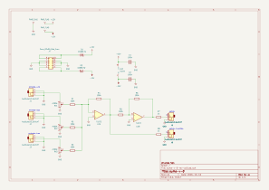
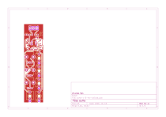

# suma

## Revisiones

- `v0.1 rev-a`: única revisión presente en el repositorio.

## Esquemático y placa (v0.1 rev-a)

Generados automáticamente por GitHub Actions a partir de `hardware/suma-v-0-rev-a/suma-v-0-rev-a.kicad_sch` y `.kicad_pcb` en cada push que los modifica.

## Bill of materials (v0.1 rev-a)

Generado a partir de `hardware/suma-v-0-rev-a/suma-v-0-rev-a.kicad_sch`.

<!-- BOM_TABLE_START -->

<!-- BOM_TABLE_END -->

## Créditos

- Aarón Montoya-Moraga: investigación, esquemático, PCB, fabricación y documentación.

## Licencia

El hardware está bajo CERN-OHL-P-2.0 y esta documentación bajo CC-BY-SA-4.0. Ver [LICENSE.md](https://github.com/piruetasxyz/suma/blob/main/LICENSE.md).
